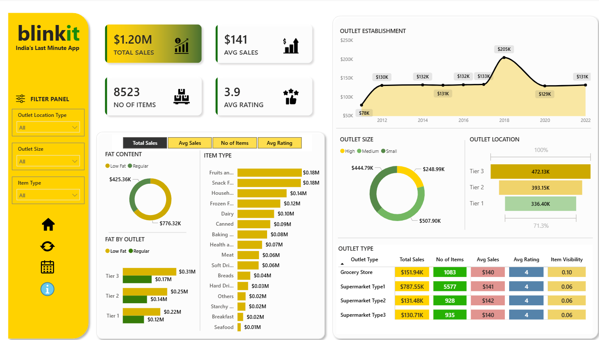

# Blinkit Sales Dashboard

A Power BI learning project built by following a Data Tutorials YouTube tutorial, with a customized dashboard layout and icons.

## Overview

The report explores sales by item type, fat content, outlet establishment year, outlet size, location tier, and outlet type. Slicers allow filtering by outlet location type, outlet size, and item type.

## Dashboard snapshot

| Metric | Displayed value |
| --- | --- |
| Total sales | $1.20M |
| Average sales | $141 |
| Number of items | 8,523 |
| Average rating | 3.9 |

These values are taken from the dashboard screenshot with the displayed filter selections.

## Open the report

1. Download `blinkit.pbix`.
2. Open it in Microsoft Power BI Desktop.
3. Explore the report using the slicers and visuals.

Refreshing the report may require updating the source file location in Power Query to your local dataset.

## Files

- `blinkit.pbix`: Power BI report.
- `dashboard.png`: Dashboard preview.

## Credits

This is a tutorial-based educational project, not an official Blinkit report.

- [Data Tutorials project reference](https://topmate.io/data_tutorials/1088523)
- [Original dataset folder](https://drive.google.com/drive/folders/1mKh61zKVBnPJN0A5lc77osGNkmNa-loI)

The original dataset is not separately redistributed in this repository. The Power BI file may contain imported data; original source permissions still apply.
